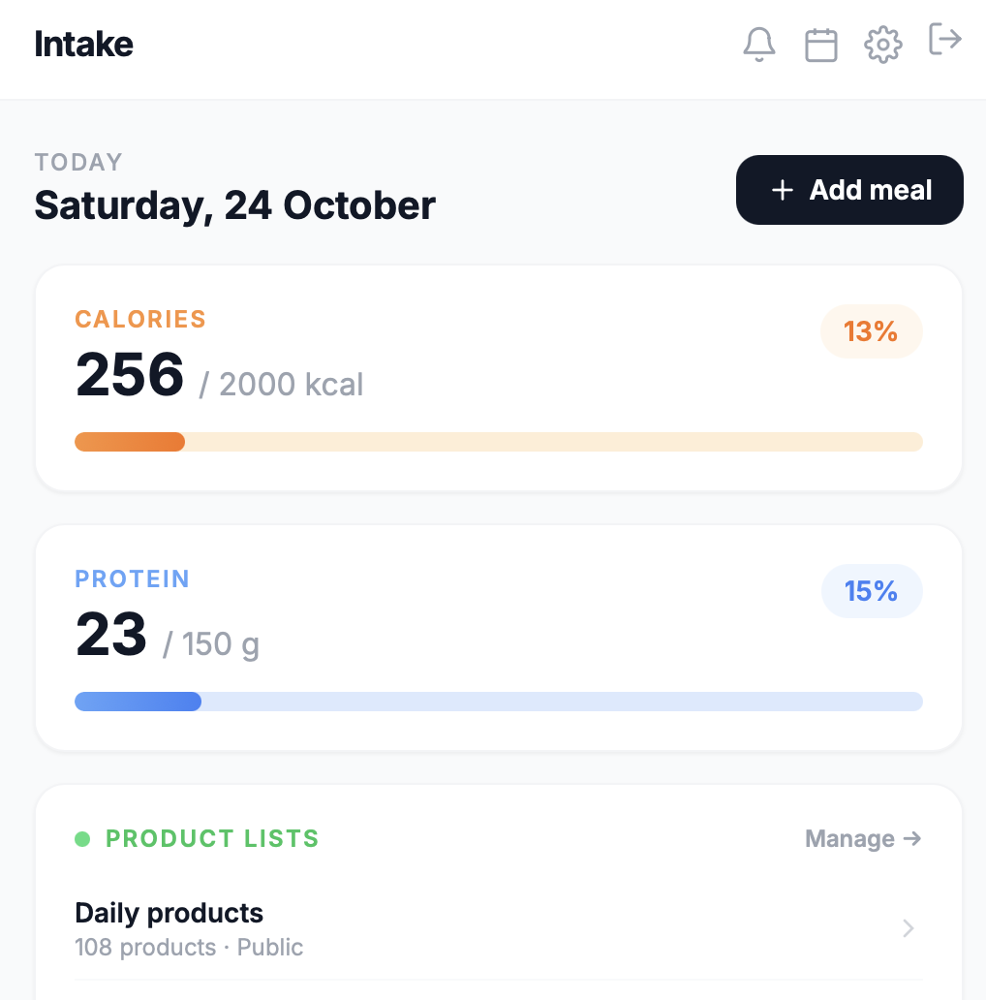
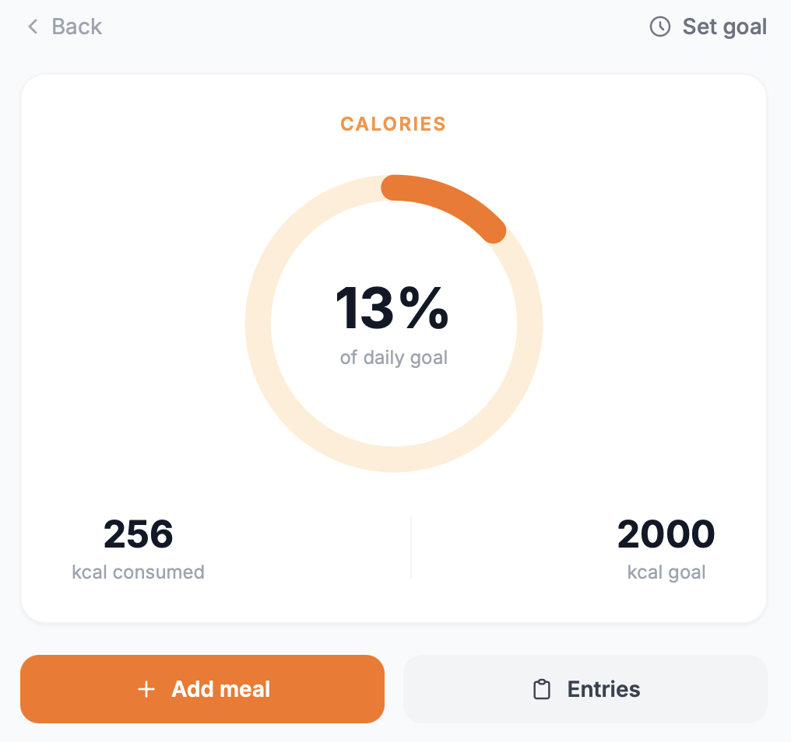
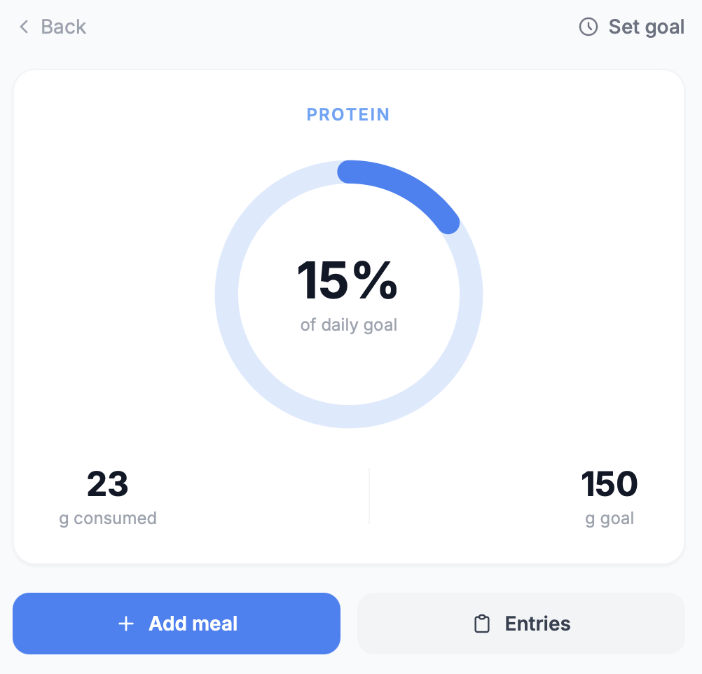
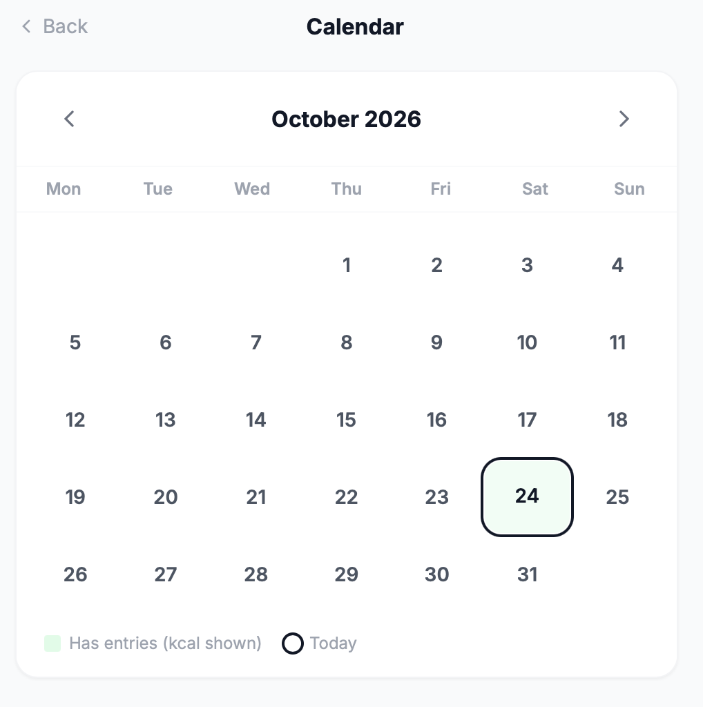
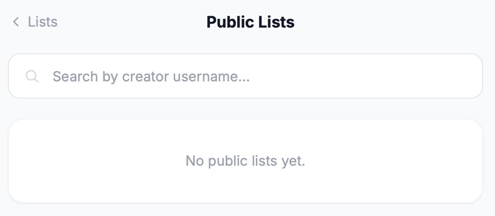
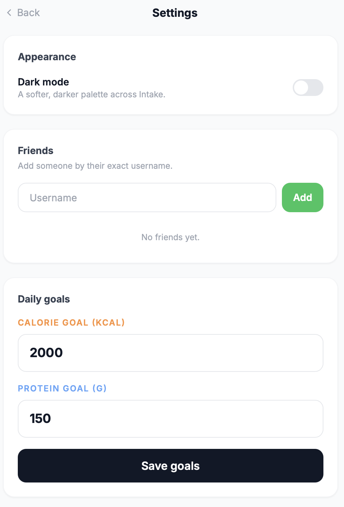
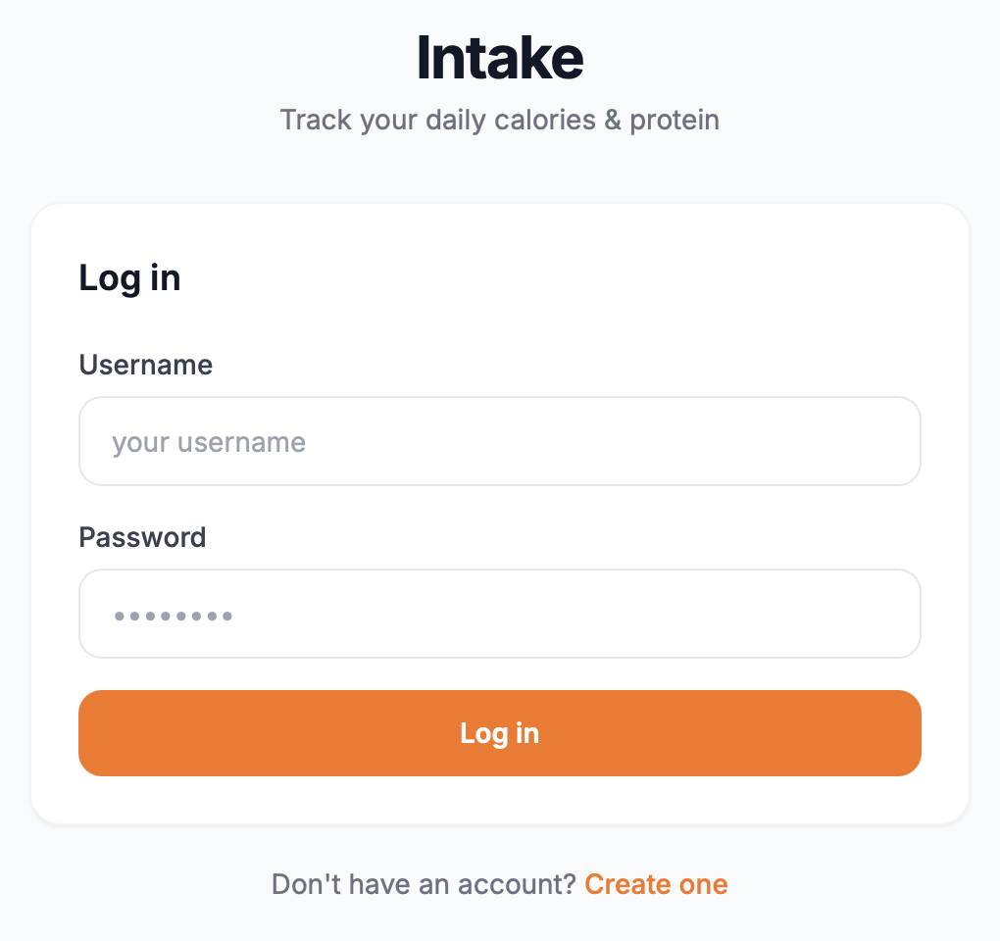

# Intake

A small Django hobby project for tracking daily calories and protein. Save the foods you eat regularly, log meals by weight, and check your progress against personal goals.



## Features

- Daily calorie and protein totals with adjustable goals.
- Meal logging from nutritional values per 100 g and portion weight.
- Reusable product lists, saved portions, and quick entry from recent meals.
- A calendar for reviewing and adding entries on previous days.
- Public product lists that other users can copy to their own account.
- Friend invitations and meal sharing, with notifications and approval before adding a shared entry.
- Light and dark themes.
- Separate user accounts, with administrator approval for new registrations.

## Screenshots

### Calories



### Protein



### Calendar



### Public lists



### Settings



### Login



## Built with

Python 3.13, Django 6, Django templates, Tailwind CSS, and vanilla JavaScript. Local development uses SQLite. Railway uses PostgreSQL, Gunicorn, and WhiteNoise.

Python dependencies are pinned in `requirements.txt`. Tailwind and the Inter font load from external services, so the interface needs an internet connection for its styling and font. No Node.js build is required.

## Run locally

Install Python 3.13, then run:

```bash
git clone https://github.com/KustronBartlomiej/Intake-Website.git
cd Intake-Website
python3.13 -m venv .venv
source .venv/bin/activate
python -m pip install -r requirements.txt
python manage.py migrate
python manage.py createsuperuser
python manage.py runserver
```

On Windows, create the environment with `py -3.13 -m venv .venv` and activate it with `.venv\Scripts\Activate.ps1` in PowerShell.

Open http://127.0.0.1:8000 and sign in with the superuser account. The database starts empty; create a product list or add a meal to begin.

New registrations are inactive until an administrator approves them. Open http://127.0.0.1:8000/admin/, select the user under **Users**, enable **Active**, and save.

## Configuration

The local defaults work without an environment file. `.env.example` lists optional settings. Django reads the process environment and does not load `.env` automatically. To use a local file in a POSIX shell:

```bash
cp .env.example .env
# Edit .env, then export its values:
set -a
source .env
set +a
```

- `SECRET_KEY`: a unique secret required for a production deployment. The built-in fallback is for local development only.
- `DEBUG`: defaults to `True`. Set it to `False` in production, using this capitalization.
- `DATABASE_URL`: a PostgreSQL connection URL. If omitted, Django uses `db.sqlite3` in the project directory.
- `ALLOWED_HOSTS`: space-separated hostnames outside Railway; defaults to `localhost 127.0.0.1`. On Railway, the existing configuration allows all hosts to accommodate internal health checks.

Railway supplies `RAILWAY_PROJECT_ID` and, once a public domain is configured, `RAILWAY_PUBLIC_DOMAIN`. The app uses the public domain for trusted CSRF origins and trusts Railway's forwarded HTTPS header. Dates use the `Europe/Warsaw` timezone.

## Checks

```bash
python manage.py check
python manage.py makemigrations --check --dry-run
python manage.py collectstatic --no-input
python manage.py test
```

The tests cover product search and copying, friend invitations, meal sharing, access restrictions, notifications, and appearance preferences. Django creates a separate test database.

## Deploy on Railway

`railway.json` contains the build, migration, start, and health-check commands. `runtime.txt` pins the Python version.

1. Create a Railway service from this GitHub repository and select `main` as its deployment branch.
2. Add a PostgreSQL service to the same project.
3. In the web service variables, set `DATABASE_URL` to `${{Postgres.DATABASE_URL}}`. Replace `Postgres` if your database service has a different name. Adding a database does not automatically connect the web service to it.
4. Set `DEBUG=False` and a unique `SECRET_KEY`. Generate a key locally with `python -c "import secrets; print(secrets.token_hex(50))"`.
5. Generate a public domain for the web service and deploy.
6. In the running web container, run `python manage.py createsuperuser`, then sign in and approve any registered accounts.

The build installs dependencies and collects static files. Migrations run in the pre-deploy step, followed by Gunicorn. Railway checks `/auth/login/` before switching traffic to the deployment. Use PostgreSQL for deployed data; SQLite on the container filesystem is not persistent across deployments.

After deployment, check the login page, sign in, add a meal, and confirm that the daily totals and calendar update. The Django admin should also load its styles correctly.

See the [Railway Django guide](https://docs.railway.com/guides/django) and [variable reference documentation](https://docs.railway.com/variables) for platform setup.

## Stopping and restoring the service

The hosted instance may be offline. The application can still run locally or be deployed again from `main`.

Before retiring a deployment, keep a full PostgreSQL backup outside the repository and store the service variables securely. Preserve the database service and its volume if you intend to reuse them. Stopping the web service alone does not stop or remove the database.

For an independent backup, use PostgreSQL client tools compatible with the server version. Set `DATABASE_URL` in your terminal to the database's externally reachable connection URL, then run:

```bash
pg_dump --format=custom --no-owner --no-acl --file=intake.dump "$DATABASE_URL"
```

Run this from a private backup directory outside the repository. Keep the dump securely: it contains user data and password hashes. Verify it by restoring it into a separate empty database before removing the original database.

To restore into a new, empty PostgreSQL database, set `DATABASE_URL` to its connection URL and run:

```bash
pg_restore --no-owner --no-acl --dbname="$DATABASE_URL" intake.dump
```

Then connect the Railway web service to that database, restore the service variables, and deploy `main`. The pre-deploy step applies any pending migrations. Existing accounts remain available after a full database restore; create a superuser only when starting with an empty database.

If the original database is still available, reconnect to it and redeploy without restoring a dump. Check login, meal history, product lists, and static files after restarting.
